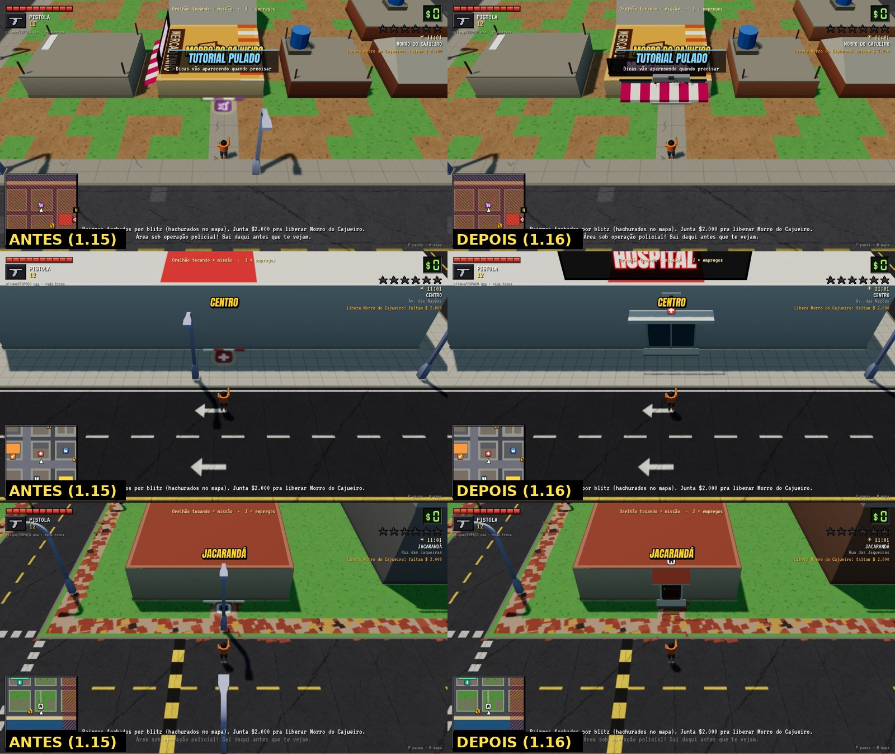
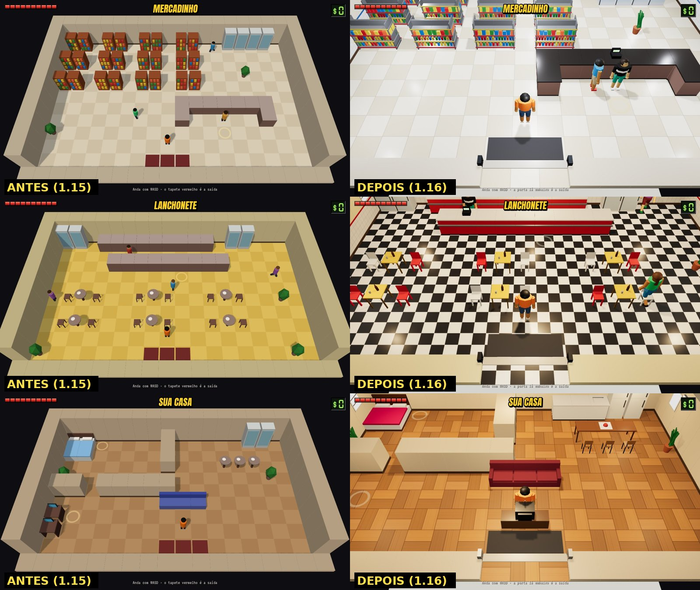
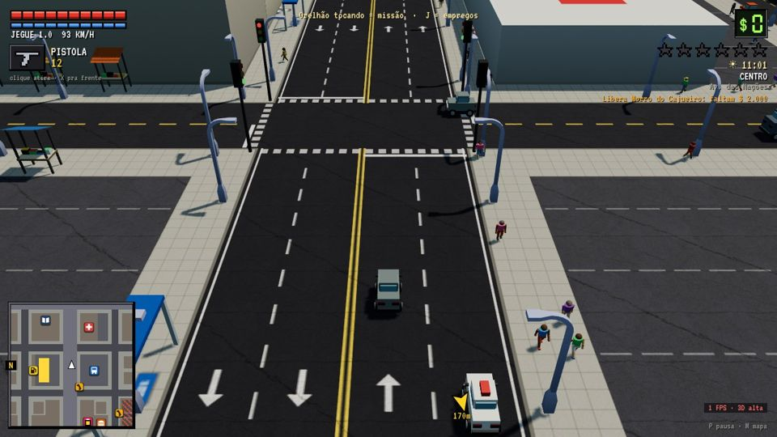
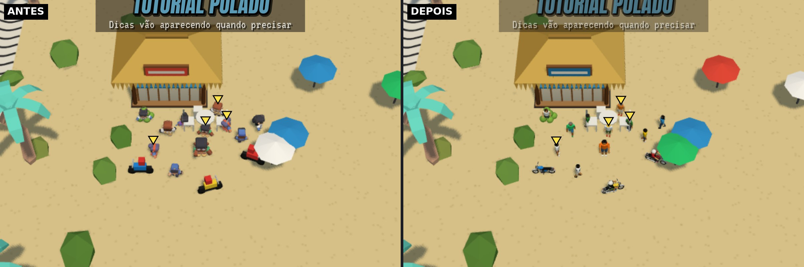
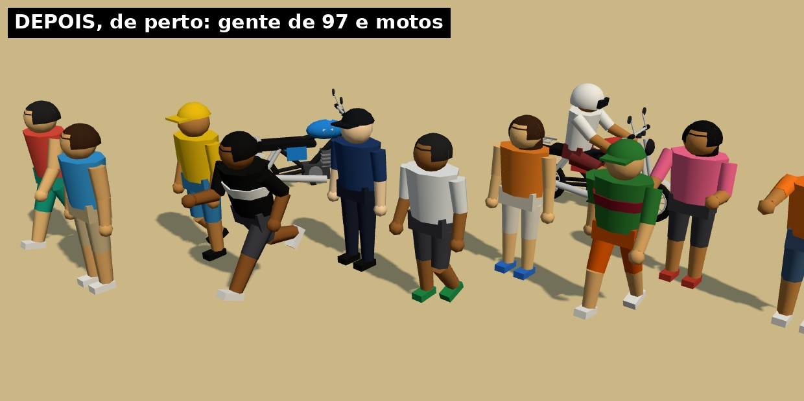
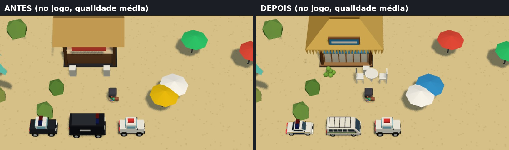

# Histórico de versões

O número segue o padrão `MAIOR.MENOR.CORREÇÃO`:
- **MAIOR** — mudança grande no jogo (ainda 0 enquanto é protótipo)
- **MENOR** — novidade (sistema, missão, veículo, reorganização)
- **CORREÇÃO** — conserto de bug ou ajuste pequeno

## 1.16.0 — 24/11/2026
**Portas de verdade viradas pra rua, e interiores novos**

- **Porta de verdade** em todo lugar que dá pra entrar, no lado que dá pra rua: comércio com a porta de aço de enrolar recolhida, o vão aberto mostrando a prateleira e vitrine dos lados; porta de vidro na farmácia e no posto; grade e aço meio baixado no Tonhão; porta de madeira com telhadinho, capacho e arandela na sua casa; porta de vidro com marquise no hospital (placa com a cruz) e na Carceragem (luz azul); portão de ferro verde na escola. As placas não têm letra
- **Tudo virado pra rua**: o toldo e o letreiro de neon iam sempre pro lado sul do prédio, mesmo quando a porta ficava em outro lado (às vezes de costas pra rua). Agora ficam em cima da porta, e a luz colorida do neon cai na calçada certa. Visto de trás, o letreiro mostra a chapa escura (não o texto espelhado)
- **Sem o quadradinho no chão**: no 3D o ícone do lugar flutua em cima da porta (aparece de longe e some quando chega perto, onde aparece o F). No chão só um brilho quando você está na porta. Poste não fica mais plantado na frente de porta
- **Sair** te deixa na calçada do lado certo (antes sempre saía pro sul), virado e com a câmera olhando pra rua
- **Interiores na qualidade da rua**: piso com textura (cerâmica, xadrez de lanchonete, granilite de repartição, taco em casa e na escola), azulejo branco com faixa colorida na padaria, lanchonete, farmácia e hospital, barra de tinta na escola e na delegacia, rodapé, janelas basculantes que clareiam e escurecem com a hora, luminárias de parede, relógio e quadros
- **Luz de lâmpada**: fluorescente branca nas lojas e repartições, amarelada em casa, na lanchonete e na padaria, com sombra dos móveis e reflexo no piso e no balcão
- **Móveis de 97 feitos pro jogo**: gôndola de mercadinho com faixa de preço e centenas de caixinhas, latas e garrafas; geladeira de vidro acesa por dentro; balcão com tampo de granito e caixa registradora; vitrine de salgados e pão nas prateleiras da padaria; mesa de bar de lata amarela com cadeira de plástico; longarina azul no hospital, leito com soro; computador de tubo bege nas mesas; carteira escolar; espada-de-são-jorge no vaso; e em casa pia, geladeira com filtro de barro, mesa com fruteira, sofá vinho, cama de casal com criado-mudo e abajur, e televisão de tubo na estante
- **Pessoas iguais às da rua** lá dentro (o mesmo boneco de 97, com roupa sorteada; na escola os alunos sentados de frente pro quadro)
- **Saída**: no lugar do tapete vermelho, o vão da porta com soleira e a calçada lá fora (clara de dia, escura de noite)
- **Câmera 3/4 dentro também**: segue o jogador por trás, macia, sem sair da sala. A tecla C continua trocando pra de cima, que mostra a sala inteira

## 1.15.1 — 23/11/2026
**Câmera a pé que acompanha, e polícia sem atraso**

- **A pé** a câmera segue macia, um pouco à frente de onde você anda, e gira devagar pra trás do jogador quando ele muda de rumo (andar pra trás não faz ela dar meia-volta). Mirar com o mouse não gira a câmera. W anda pra frente da tela, A e D pros lados, e o rumo não muda no meio do passo enquanto a câmera gira
- **Polícia sem atraso**: na missão "Fuga pela Beira-Mar" a polícia começava sem saber onde você estava e saía rodando pro lado errado. Agora ela já sabe. E quando perde você de vista, corre pro último lugar onde te viu (antes ia a 150, devagar como quem vasculha) e enxerga um pouco mais longe (620 em vez de 480), já que a câmera nova mostra mais da rua
- **Erro na tela** agora mostra também o arquivo e a linha onde aconteceu, pra achar mais fácil. Um ponto de missão que podia dar "Cannot read properties of null (reading 'x')" quando não achava rua em bairro aberto foi protegido

## 1.15.0 — 23/11/2026
**Câmera 3/4 atrás do carro** (a de cima continua na tecla C)

- **Câmera nova por padrão**: fica atrás do carro, inclinada, e gira junto com ele. Nas curvas ela vem com um pouco de atraso, e quanto mais rápido, mais ela se afasta. De ré ela não dá meia-volta
- **Prédio no caminho**: quando um prédio ficaria entre a câmera e o carro (encostado numa parede, por exemplo), a câmera sobe e chega mais perto até enxergar de novo
- **Minimapa gira junto** com a câmera (a frente fica pra cima) e o **N** anda pela borda apontando pro norte
- **Seta do alvo** aponta certo mesmo com o alvo atrás da câmera
- **Carros e pedestres** não nascem mais na frente da câmera lá longe (a vista nova enxerga mais longe pra frente)
- **A pé** a câmera fica na última direção do carro. W anda pra frente da tela, A e D pros lados
- **C** troca entre a 3/4 e a câmera de cima de antes. A escolha fica salva

## 1.14.1 — 23/11/2026
**Correção: tela congelava com fumaça ou faísca na tela** ("_M is not defined")
- A 1.14.0 apagou junto com os bonecos antigos umas variáveis que a fumaça, as faíscas e o fogo também usavam. A tela travava (o som seguia) assim que aparecia qualquer partícula, como a poeira da moto na areia

## 1.14.0 — 23/11/2026
**Gente de 97 e motos novas, feitas pro jogo** (sem modelo pronto, sem marca real)

- **Pessoas novas**: boneco com braço, antebraço, coxa, canela e pé, que anda balançando os braços, corre inclinado, fica parado respirando e cai. O jogador também soca e mira
- **Roupa carioca de 97** sorteada pra cada um: regata, camiseta, camisa de time inventada, bermuda, short ou jeans, chinelo ou tênis, boné e cabelo comprido. A polícia vai de farda, coturno e quepe
- **Moto nova**: 125 de rua com tanque e tampa lateral na cor da moto, banco comprido, farol redondo, garfo e para-lamas cromados, rodas raiadas que giram, escapamento e bagageiro
- **Quem pilota aparece** sentado na moto e de capacete (antes a moto andava sozinha)
- Mais leve que antes: saíram os bonecos com esqueleto; todo mundo é desenhado de uma vez (300 pessoas custam menos de 0,6 ms por quadro)

## 1.13.0 — 23/11/2026
**Modelos de 97 feitos pro jogo: viatura, lotação e quiosque de palha** (formas e nomes próprios, sem marca real)

- **Viatura nova**: sedã de três volumes dos anos 90, branco, com portas azul-marinho escrito POLÍCIA, friso dourado e giroflex em barra no teto. Vale em todas as qualidades do 3D (no lugar da viatura de modelo pronto)
- **Lotação no trânsito**: van alta de nariz curto, branca com faixas verde e amarela, porta corrediça, bagageiro e placa "CENTRO" no para-brisa. Roda no Centro, Jacarandá, Morro do Cajueiro e Vila dos Pescadores, e dá pra roubar como qualquer carro
- **Quiosque da Praia do Recanto caprichado**: telhado de palha de quatro águas com franja, balcão de tábua branca com tampo azul, prateleira de garrafas, cocos verdes, mesinha e cadeiras de plástico. A placa ficou com uma faixa clara, pronta pro nome
- Os três são leves (cerca de 1.200 triângulos cada)

## 1.12.0 — 23/11/2026
**Luz de verdade: a cidade reflete e ilumina** (a luz deixa de ser chapada em qualquer hora)
- **Postes, faróis, sirene, neon e fogo viram luzes de verdade**: iluminam o chão, as paredes, os carros e as pessoas, em vez de só uma mancha pintada no chão
  - Postes: luz de sódio alaranjada saindo da cúpula, em cima da rua (os mais perto da câmera; trocam suave, sem piscar)
  - Faróis: o seu carro e os carros mais perto jogam um facho que clareia o asfalto, as calçadas e quem estiver na frente
  - Sirene: a viatura mais perto na perseguição pinta as paredes e os carros de vermelho e azul
  - Neon dos comércios (farmácia, hospital, bingo...): a fachada e a calçada pegam a cor do letreiro, piscando junto
  - Explosões, carro pegando fogo e tiros clareiam em volta
- **3D alta agora tem reflexo**: lataria com verniz, vidros e mar refletindo o céu da hora, brilho do sol nas superfícies, texturas no chão e nas paredes (antes só o realista tinha). O realista continua com o brilho (bloom), sombras suaves e mais luzes
- 3D média ganha postes e faróis iluminando (sem reflexo); 3D leve fica como era
- Pessoas, árvores e casas de modelo ganham um pouco de brilho na luz
## 1.11.0 — 23/11/2026
**Guanabara, 1997: a cidade ganha cara de Rio** (primeira etapa do [design](docs/design.md), ainda no mapa antigo)
- **Nomes novos**, seguindo a regra dos nomes do design: Jacarandá (era Jardim Maresia), Morro do Cajueiro, Barra Sul, Praia do Recanto, Vila dos Pescadores e Cais do Porto. Avenidas: Via Expressa, Av. das Nações, Av. Aurora, Estrada dos Tropeiros, Av. do Cais. Ruas e becos com nome de samba, feira e choro no lugar dos nomes cearenses
- Estádio do Jacarandá (Jacarandá FC, Unidos do Recanto, Colônia AC), Carceragem Central no lugar da delegacia, Posto Guanabara, guia de ruas "Guanabara" e "GUANABARA · 1997" na tela de título
- **Cada bairro com a sua decoração** (só visual, o traçado e os lugares não mudam):
  - Centro: camelódromo com barracas de lona na calçada, bancas de jornal, letreiros de FOTO 1 HORA, HOTEL GUANABARA e LOTERIA que acendem à noite
  - Jacarandá: calçada de caquinho vermelho e bancas de jornal
  - Morro do Cajueiro: casinhas com laje, caixa d'água azul e ferro esperando o próximo andar; as outras com telha de amianto
  - Barra Sul: outdoors da BarraSul Incorporações e de lançamentos, letreiro do BINGO ESTRELA piscando à noite
  - Praia do Recanto: quiosques de madeira com telhado de palha e moitas de restinga na areia
  - Vila dos Pescadores: barcos de madeira e redes de pesca estendidas
  - Cais do Porto: guindastes de pórtico com lança sobre o mar
  - Orelhão com a concha laranja de verdade
- Saves antigos continuam valendo (o mapa é o mesmo)

## 1.10.2 — 21/11/2026
**Logo numa linha só**
- Na tela de título, o "97" fica do lado de MARESIA (antes ficava embaixo); o subtítulo e o menu subiram

## 1.10.1 — 21/11/2026
**3D realista mais leve**
- O reflexo do céu era refeito quase todo quadro (a cor do céu muda um pouquinho conforme a hora anda) e recompilava shaders. Agora é refeito no máximo a cada 1,5 s, sem alocar nada de novo. Os quadros mais lentos caíram de ~28 ms pra ~21 ms, igual ao 3D alta
- Corrigido um vazamento de memória no realista: os pedaços de chão que ficavam longe deixavam a cópia do material pra trás
- Em telas de alta densidade o realista desenha até 1,5x (antes 2x)
- Novo [documento de design](docs/design.md) com a direção das próximas versões (história em capítulos e investigação)

## 1.10.0 — 21/11/2026
**Texturas de verdade e mapa mais fácil de ler**
- **3D realista com texturas fotográficas** (Poly Haven, licença CC0): asfalto com grão e rachaduras, paralelepípedo com pedras em relevo, areia, grama, terra, placas de concreto nas calçadas e reboco nas paredes. As faixas, as cores de cada bairro e as marcas de pneu continuam as mesmas; a foto entra por cima como grão e relevo, que pega a luz do sol
- As calçadas com desenho próprio (ondas da Orla, tijolo da Vila Velha) ganham só um grão leve
- **Mapa (M)**: o índice e a legenda mostram o mesmo símbolo que aparece no mapa ao lado de cada nome. Entraram no índice o Terminal de ônibus e o Ponto de táxi, e na legenda o seu marcador

## 1.9.0 — 21/11/2026
**Mais modelos 3D e gráficos realistas**
- **Árvores, coqueiros, postes e casas com modelos 3D** do Kenney (Nature Kit, City Kit Roads e City Kit Suburban, licença CC0). As casas do Jardim e as mansões do Alto da Maresia ficam de frente pra rua, e os postes viram o braço pra rua mais perto
- **Pessoas animadas**: o jogador e os 20 pedestres mais perto da câmera usam os Mini Characters do Kenney, que andam, correm, socam, seguram arma e caem. Os mais longe continuam com o boneco simples (mais leve)
- Cones de verdade na blitz
- **Gráficos "3D realista"** (novo nível no menu Gráficos e na tecla G): lataria com verniz, vidros e mar refletindo o céu, o céu de cada hora iluminando a cidade, sombras de borda suave, tone mapping de cinema e brilho (bloom) em néon, faróis e janelas à noite. Precisa de uma placa de vídeo melhor; se o jogo ficar lento, volta sozinho pro 3D alta
- Os modelos aparecem nas qualidades média, alta e realista; na leve a cidade continua com as peças feitas por código

## 1.8.0 — 20/11/2026
**Cidade maior e gente do tamanho certo**
- **A cidade cresceu**: de 262 pra 376 tiles de lado (uns 2× de área). Os quarteirões têm o mesmo tamanho, mas cada bairro ganhou mais ruas. Centro e Jardim, que já vêm abertos, ficaram com mais que o dobro de espaço pras missões
- Ruas novas: Rua da Jangadinha, Rua do Caju, Rua da Renda, Rua das Dunas, Rua do Coqueiral, Rua da Lagosta, Rua da Peixada, Rua do Cais e mais becos na Vila Velha
- **Mais coisa aberta no começo**: os dois Postos Maresia, a Oficina do Zé e parte das lanchonetes, mercadinhos, farmácias e padarias agora ficam no Centro e no Jardim. Dá pra trabalhar de motoboy, busão e guincho desde o início
- Mais comércio (8 farmácias, 10 mercadinhos, 6 padarias, 4 escolas, 10 lanchonetes) e 22 orelhões
- **Pessoas na proporção certa**: antes um pedestre tinha a altura de um carro inteiro; agora tem uns 1,9 m perto dos carros e prédios. O jogador é um pouquinho maior pra ser fácil de achar
- Saves de antes desta versão continuam valendo (dinheiro, bairros, missões), mas começam no hospital, porque a cidade mudou

## 1.7.0 — 20/11/2026
**Carros com modelos 3D**
- Os carros agora usam modelos 3D do **Car Kit do Kenney** (licença CC0): Jegue, Brisa GT, Táxi, Caminhonete, Guincho, Sedã Executivo, Utilitário, Caminhão Baú, Viatura, Van da SWAT, Sedã do FBI e Jipe do Exército
- Cada carro continua com a cor dele (a lataria do modelo é repintada) e as rodas giram
- Busão, Motoca, Bugue e Blindado seguem com o visual antigo, porque o kit não tem esses veículos
- Na qualidade gráfica **leve** (tecla G), os carros voltam pro visual antigo, que pesa menos
- Se os modelos demorarem ou não carregarem, o jogo usa os carros antigos

## 1.6.0 — 20/11/2026
**Maresia 97: nome novo e visual caprichado**
- O jogo agora se chama **Maresia 97** (tela de título, aba do navegador e documentação). Os saves continuam valendo
- **Mar de verdade dentro do mapa**: a água da praia e do porto agora tem ondas, fica turquesa no raso e faz espuma batendo na areia
- **Luz por hora do dia**: amanhecer rosado, meio-dia claro, fim de tarde dourado com sombras compridas, pôr do sol laranja, crepúsculo roxo e noite com luar azulado (dá pra enxergar a cidade). Luz dos postes alaranjada, sem estourar
- **Carros mais bonitos**: rodas redondas com calota, para-choques, vidros em volta da cabine, retrovisores, cabine da cor do carro, caçamba nas caminhonetes e braço no guincho. De noite, as lanternas brilham vermelho no chão (mais forte freando)
- **Cidade com mais detalhe**: paredes com sombra perto do chão, rodapé, moldura no topo dos prédios, toldo listrado nas lojas, antena de TV nas casas, aquecedor solar e casa de máquinas nos telhados, árvores mais cheias e coqueiros com coco
- **Batidas soltam faíscas e poeira**

## 1.5.2 — 20/11/2026
**Correções nos empregos, na Arena e na missão Acerto de Contas**
- **Guincho** não trava mais o jogo quando o posto e a Oficina do Zé estão fechados pela operação: o turno nem começa, ou termina com aviso se fecharem no meio do serviço
- **Vigilante** não começa mais turno entre 5h e 7h, e o bônus do amanhecer só sai pra quem fez pelo menos 2 horas de turno
- **Arena** tem jogo todo dia de novo: o dia agora vira à meia-noite do relógio do jogo (também dormindo) e fica no save. Antes, depois de dormir ou carregar o jogo, alguns dias ficavam sem partida e sem aposta
- **Acerto de Contas**: as caminhonetes da gangue não nascem nem entram mais em bairro fechado (antes dava pra ter que furar blitz pra pegar uma)
- **Motoboy**: subir numa Motoca da rua e apertar J com todas as lanchonetes fechadas não abre mais um turno que acaba na hora; aparece o aviso de que estão fechadas pela operação, e a dica do J já avisa antes
- **Bloqueios da polícia** nunca passam de 4 carros ao mesmo tempo (antes podiam chegar a 6)
- Documentação: ordem do F3 corrigida (o primeiro toque abre o painel completo)

## 1.5.1 — 20/11/2026
**Ajustes depois do teste da 1.5.0**
- **Filtro 97 desligado por padrão** (a cidade fica nítida). Continua opcional na tecla V ou no menu Gráficos
- **Avisos grandes menores**: viraram uma faixa compacta no alto da tela, sem tremer nem tapar a rua; nome do bairro e "PARADO AÍ!" também diminuíram
- **Mapa mostra claramente onde pode entrar**: bairro fechado fica vermelho listrado com linha forte na divisa, triângulo vermelho em cada posto de blitz e legenda "Pode entrar / Fechado (blitz)"

## 1.5.0 — 20/11/2026
**Visual 97: interface nova e cidade com cara de jogo de 1997**
- Fontes novas: **VT323** (texto, estilo terminal) e **Anton** (títulos de impacto), salvas no jogo, funcionam sem internet
- HUD redesenhado:
  - dinheiro num **visor LCD de 7 segmentos**, que rola contando quando entra ou sai grana
  - **estrelas em pixel**; a que acabou de acender pisca branca
  - **vida, colete e lataria em blocos** (piscam quando estão no fim)
  - arma numa caixinha com desenho em pixel e munição ao lado
  - missão e emprego chegam no **bip** (pager) no topo, que bipa e treme quando chega mensagem nova; cronômetro no visor LCD
  - nome do bairro entra grande e inclinado ao cruzar a divisa
  - minimapa com moldura chanfrada e **N** em cima; a linha fixa de atalhos saiu da tela (fica em Controles)
  - mira em pixel, borda vermelha pontilhada ao levar dano e pulsando com vida baixa
- **Tela de título e pausa com menu**: Continuar/Começar, Novo jogo (com confirmação), Controles, Gráficos, Filtro 97 e Som. O resumo do save aparece no bip
- **Mapa (M) como guia de ruas de papel**: grade A–H × 1–8, avenidas em amarelo, carimbo vermelho de **BLITZ** nos bairros fechados e índice com a casa da grade do lugar mais perto de cada tipo
- **Lojas** como tabela de preço: linha pontilhada até o valor, escolha em amarelo, item indisponível apagado com o motivo
- Mensagens grandes em letra de impacto, entrando com tranco
- Interiores com o mesmo HUD enxuto (título, LCD e blocos)
- 3D:
  - **Filtro 97** (ligado por padrão, tecla **V** ou no menu): resolução baixa com pontilhado e menos cores, como placa de vídeo da época. Deixa o jogo mais leve
  - **mar com ondas** facetadas e brilho do sol, cor muda com a hora
  - **letreiros nos comércios** (Farmácia, Lanches, Posto, Tonhão, Oficina do Zé, Pintura, Padaria, Mercadinho, Hospital, Polícia): pintados de dia, neon aceso à noite, com brilho na qualidade alta; farmácia e lanchonete dão aquela falhada
  - céu e neblina com cores mais quentes no pôr do sol
  - câmera abre um pouco com a velocidade
- Sensação de jogo: batida forte dá um **congelamento de 60 ms** além do tranco na câmera
- Contador de FPS foi pro canto de baixo

## 1.4.0 — 20/11/2026
**Bairros liberados por meta (Operação Maré Alta)**
- A cidade está sob operação policial: começam abertos só o **Centro** e o **Jardim Maresia** (onde ficam sua casa, hospital, delegacia, pintura e armas)
- Os outros bairros abrem ao juntar dinheiro, nesta ordem: **Alto do Cajueiro** ($2.000) → **Alto da Maresia** ($5.000) → **Orla** ($10.000, Oficina do Zé) → **Vila Velha** ($16.000) → **Porto** ($25.000)
- Ao bater a meta, o contato "desenrola" e a blitz daquele bairro é desmontada (aviso grande na tela)
- **Blitz** em cada rua que entra num bairro fechado: cones afunilando, cancela listrada, placa, tapete de pregos, duas viaturas na calçada e policiais em pé
  - devagar: "Área sob operação, só morador. Volta!" e o carro é barrado; a pé, a grade não deixa passar
  - rápido: quebra a cancela, ganha **3 estrelas** na hora, a blitz vem atrás e o tapete de pregos **fura os pneus** (carro lento e escorregando até consertar no posto)
  - dentro de bairro fechado a operação te acha em poucos segundos e não larga (mínimo 3 estrelas)
- As avenidas da divisa entre bairros continuam livres
- Mapa e minimapa mostram os bairros fechados hachurados em vermelho, com a meta escrita; o HUD mostra quanto falta pro próximo
- Missões, empregos, orelhões e o tutorial só mandam pra bairros abertos; a missão do Brisa espera a Orla e o Alto da Maresia abrirem
- Saves antigos: dinheiro zerado e só Centro e Jardim abertos

## 1.3.0 — 20/11/2026
**Procurado que escala (agora até 6 estrelas)**
- 1–3 estrelas: viaturas, bloqueios e policiais a pé (como antes)
- 4 estrelas: **SWAT** — van blindada que aguenta muito mais batida e desce 3 agentes com submetralhadora e colete
- 5 estrelas: **FBI** — sedãs pretos mais rápidos que quase tudo, que preferem te cortar pela frente
- 6 estrelas: **Exército** — jipes, **blindado** (quase indestrutível) e soldados com colete; o bloqueio vira blindado no meio da rua
- Policiais com colete (SWAT, FBI, exército) aguentam vários tiros
- Aviso grande na tela quando entra cada força nova

**Formas de esfriar**
- **Se esconder**: parado (ou bem devagar) num beco ou num estacionamento, fora de vista, as estrelas caem 3x mais rápido
- **Trocar de carro sem ninguém ver**: a polícia perde a placa e cai 1 estrela
- **Pintura Express** continua apagando tudo, mas agora custa $500 por estrela

## 1.2.0 — 20/11/2026
**Interiores em 3D**
- Mercadinho, farmácia, padaria, loja do posto, lanchonete, hospital, delegacia, loja de armas, escola e sua casa agora são salas em 3D, montadas a partir da mesma planta em texto
- Câmera fixa olhando da porta, com a parede da frente cortada pra dar pra ver tudo; luz e sombras próprias
- Prateleiras com produtos, geladeiras com bebidas, balcões, mesas com prato, cadeiras, camas (a de casal é uma só), computadores, quadro-negro, carteiras com livro, plantas, sofá, arara de armas, alvos do estande e cela com grade
- Anel no chão marca os pontos de atendimento (pulsa no mais perto) e o aviso com tecla acompanha em 3D
- No modo clássico (G) os interiores continuam como antes, vistos de cima

## 1.1.5 — 20/11/2026
- Painel F3: corrigido o diagnóstico do gargalo (somava os tempos como texto e sempre culpava o processador)

## 1.1.4 — 20/11/2026
- Contador de FPS um pouco menor e mais alto, pra não encostar na linha de dicas/missão

## 1.1.3 — 20/11/2026
- **Contador de FPS e qualidade no topo da tela** (ex.: `58 FPS · 3D alta`), verde/amarelo/vermelho conforme o desempenho
- **F3 agora tem três estados**: contador pequeno → painel de desempenho completo → desligado (a escolha fica salva no navegador)
- A dica acima do minimapa mostra a tecla F3

## 1.1.2 — 20/11/2026
- **F3 abre um painel de desempenho**: FPS, tempo da lógica e do desenho, resolução real do 3D, chamadas de desenho e **qual placa de vídeo o navegador está usando** (avisa se for a integrada) e se o gargalo é a placa ou o processador

## 1.1.1 — 20/11/2026
**Fim das piscadas dirigindo no 3D** (o mesmo esquema dos jogos de mundo aberto: streaming + LOD)
- O chão é carregado aos poucos (no máximo 3 pedaços por quadro), primeiro o que está na tela e depois pra onde o carro está indo
- Por baixo fica o mapa inteiro em baixa resolução: se um pedaço ainda não chegou, aparece ele em vez de um buraco
- Só carrega a área que aparece na tela (antes carregava quase o dobro)
- A sombra cobre toda a área vista, mesmo com a câmera afastada, e não treme mais nas bordas quando o carro anda
- Marcas de pneu e detalhes do chão não dão mais pulo quando o carro anda rápido
- Os efeitos (sirene, freio, explosão...) são preparados na placa de vídeo ao iniciar, sem engasgo na primeira vez

## 1.1.0 — 20/11/2026
**Desempenho do 3D**
- A cidade agora é dividida em blocos: a placa de vídeo só desenha o que está perto da câmera (antes desenhava o mapa todo a cada quadro, duas vezes por causa das sombras). Cerca de 3x menos triângulos e metade das chamadas de desenho por quadro
- Pessoas e partículas desenhadas todas de uma vez; carros com bem menos peças
- O canvas 3D só é redimensionado quando a janela muda (antes era a cada quadro, o que recriava os buffers da placa)
- Sombras mais leves e o brilho dos refletores do estádio deixou de ser uma luz de verdade (pesava na cidade inteira)
- **Três níveis de qualidade**: G passa por 3D alta → 3D média → 3D leve → clássico. A média usa resolução normal e sombras menores; a leve renderiza em resolução reduzida e sem sombras
- Se o jogo rodar abaixo de ~35 quadros por segundo por alguns segundos, a qualidade baixa sozinha (e fica salva)

## 1.0.0 — 19/11/2026
**Gráficos em 3D** (Three.js; a lógica do jogo continua a mesma)
- Câmera inclinada acima do jogador, que afasta com a velocidade
- Prédios em 3D com janelas, telhado de duas águas nas casas, caixa d'água e ar-condicionado em cima; janelas acendem à noite
- Telhados dos lugares especiais com as placas e ícones (livro da escola, cruz do hospital, estrela da polícia...)
- Sol que cruza o céu durante o dia, com sombras de verdade; céu e neblina mudam de cor no pôr do sol e à noite
- Árvores, coqueiros com folhas, guarda-sóis, postes com poça de luz à noite, semáforos com luz acesa, orelhões, pontos de ônibus, bombas de gasolina e guindastes
- Arena Maresia em 3D: arquibancada inclinada, torcida que pula em dia de jogo e refletores que iluminam o gramado
- Carros em 3D para cada modelo (ônibus com janelas, caminhão, moto com piloto, viatura com giroflex), luz de freio, faróis que iluminam a rua à noite
- Pessoas em 3D com pernas que andam
- Fumaça, fogo, explosões e rastros de tiro em 3D
- Avisos com tecla, setinhas e dinheiro flutuante acompanham os objetos em 3D; a mira do mouse aponta direto no chão em 3D
- **G alterna entre 3D e o visual clássico (2D)** e a escolha fica salva; se o computador não tiver 3D, o jogo usa o clássico sozinho
- Se o computador não aguentar, o jogo reduz a resolução e depois as sombras automaticamente
- Interiores continuam no visual de cima
- Three.js incluído no repositório (pasta vendor/three, licença MIT)

## 0.10.0 — 19/11/2026
**Arena Maresia (estádio)**
- Estádio no Centro, ocupando o espaço de 4 quarteirões: arquibancada inclinada, gramado com marcação, 4 portões e 4 refletores que acendem à noite e em dia de jogo
- Dia de jogo todo dia das 15h30 às 18h: Maresia FC contra um adversário diferente a cada dia (times inventados)
- Arquibancada lota com a torcida nas cores dos times, torcida chega na praça em volta e dá pra ouvir o barulho de perto
- Gols acontecem durante o jogo e aparecem na tela se você estiver perto; placar ao vivo em cima do estádio
- Bilheteria (F no portão de baixo): assistir ao jogo ($20, pula até o fim e recupera um pouco de vida), apostar $100 no Maresia FC (paga 2,5x) e ver o placar
- Ícone de estádio no minimapa, no mapa e na legenda
- O hospital e um dos postos mudaram de lugar pra abrir espaço

## 0.9.3 — 19/11/2026
- Telhado da escola agora tem um livro aberto grande (antes parecia um campo de futebol)

## 0.9.2 — 19/11/2026
- Portas de todos os comércios e lugares agora ficam viradas pra rua, no lado do prédio mais perto da calçada
- Comércio só é colocado em prédio que tem fachada pra rua (nada de entrada escondida entre dois prédios)
- Se tiver grama, terra ou árvore entre a porta e a calçada, vira um caminho de calçada
- Entrada mais fácil de achar: toldo listrado com a cor do lugar na fachada e ícone maior pulsando na porta

## 0.9.1 — 19/11/2026
- **J a pé abre o menu de EMPREGOS**: explica onde começar cada um e marca no mapa o veículo ou lugar mais perto
- Aviso com tecla J desenhada quando você está num veículo de trabalho
- Dica de primeira vez avisando que existe o menu de empregos
- Corrigido: perto de uma porta, o F entrava no comércio mesmo com o carro mais perto; agora ganha o que estiver mais perto
- Motocas das lanchonetes ficam um pouco mais longe da porta

## 0.9.0 — 19/11/2026
**Interiores onde dá pra andar**
- F (ou clique direito) na porta entra no lugar: o jogo troca pra uma cena interna vista de cima
- Cada tipo tem planta própria: loja (prateleiras e geladeiras), lanchonete (mesas), hospital (leitos e recepção), delegacia (mesas e cela), Armas do Tonhão (arara de armas e estande de tiro), escola (sala de aula com alunos) e sua casa (quarto, sala, cozinha)
- Atendente atrás do balcão, clientes andando; a compra é feita falando com o atendente
- Na casa: a cama dorme, o computador salva
- No hospital a vida vai voltando devagar enquanto você está lá dentro
- Sai pisando no tapete vermelho; procurado pela polícia não entra (só na delegacia)

**Começo guiado**
- Jogo novo começa com 5 passos curtos, ensinando jogando: andar, pegar o carro, dirigir, abrir o mapa e atender o orelhão
- Cada passo mostra as teclas desenhadas e uma seta pro objetivo; T pula o tutorial
- Depois, dicas aparecem só na primeira vez que algo acontece (primeira estrela, vida baixa, carro soltando fumaça, veículo com emprego, noite, primeira grana...)
- Avisos de interação com tecla desenhada em cima do carro e das portas ("F  Roubar Táxi", "F  Entrar: Farmácia")

## 0.8.0 — 19/11/2026
**Cidade nova** (o mapa foi refeito do zero; saves antigos continuam valendo, mas você recomeça no hospital)
- Ruas de três tipos: **avenidas** de 4 faixas mão dupla, **ruas** de 2 faixas e **becos** estreitos de mão única
- **Orla**: praia larga de areia com coqueiros, barracas, guarda-sóis, quadras de vôlei e posto de salva-vidas; hotéis altos de frente pro mar e calçadão de ondas
- **Vila Velha**: centro histórico apertado, cheio de becos de paralelepípedo e casarões coloridos geminados
- **Alto da Maresia** (bairro rico): mansões com piscina e jardim, condomínios de frente pro mar, quarteirões grandes
- **Alto do Cajueiro**: periferia com casinhas de tijolo, terra batida e campinho de várzea
- **Centro**: torres altas, praças e os principais serviços (hospital, delegacia)
- **Porto**: galpões, pilhas de contêiner e guindastes no cais
- Postes ao longo de todas as ruas, PARE na saída dos becos, semáforos em todos os cruzamentos com avenida

**Trânsito**
- Carros usam as faixas certas, trocam de faixa pra ultrapassar e pra fazer a conversão, respeitam a mão única dos becos
- Avenidas com muito mais movimento; ônibus e caminhões não entram em beco
- Carros diferentes por bairro: esportivos e sedãs de luxo no bairro rico, motos na periferia, caminhões no porto
- Veículos novos: Sedã Executivo, Utilitário e Caminhão Baú

**Polícia mais esperta**
- Só sabe onde você está se alguém te viu; quando perde o contato, vai até o último lugar onde te viu e vasculha a área
- Estrelas só caem quando ninguém te vê por alguns segundos
- Parte das viaturas tenta te interceptar pela frente em vez de só seguir atrás; viaturas novas aparecem à frente de quem está fugindo
- As viaturas se espalham pra te cercar em vez de empilhar
- A partir de 3 estrelas: bloqueios atravessados na rua à frente
- A pé: policiais descem da viatura, correm atrás de você, atiram (2+ estrelas) e te prendem se encostarem

## 0.7.0 — 19/11/2026
**Save**
- Salva sozinho a cada 45 segundos (fora de missão e sem estrelas), ao terminar missão e turno de emprego, e a cada compra
- Salvar manual na **Sua casa** (ícone de casinha, perto do hospital); lá também dá pra dormir até de manhã ou de noite
- Guarda dinheiro, vida, colete, armas e munição, cursos, progresso das missões, horário, posição e o carro em que você estava
- Tela de título: ENTER continua o jogo salvo, BACKSPACE começa do zero

**Comércios onde dá pra entrar** (F ou clique direito na porta)
- Farmácia (curativo, kit, colete), Mercadinho (lanches e raspadinha), Padaria, Lanchonete, Lojinha do posto
- Hospital (tratamento), Delegacia (pagar fiança até 2 estrelas ou se entregar), Armas do Tonhão (armas e colete)
- Escola com cursos permanentes: pontaria (tiro mais preciso), direção (carro mais firme) e primeiros socorros (renasce com meio colete)
- Colete à prova de balas: barra cinza embaixo da vida, absorve a maior parte do dano
- Portas marcadas no chão com o ícone do lugar; o mundo pausa enquanto o menu está aberto

**Mapa e ícones**
- Mapa em tela cheia (M ou TAB) com bairros, legenda, polícia, objetivo e sua posição
- Clique no mapa marca um destino (seta e marcador rosa); clique direito apaga
- Letras trocadas por ícones desenhados com cor própria: cruz vermelha (hospital) e cruz verde (farmácia), estrela (polícia), chave (Zé), gota (pintura), mira (armas), bomba de gasolina (posto), hambúrguer, carrinho, pão, livro, casa, ônibus, táxi e orelhão

## 0.6.0 — 19/11/2026
**Empregos** (aperta J pra começar e pra encerrar o turno)
- **Taxista** (Táxi): busca o passageiro acenando e leva no destino. Paga mais se chegar rápido; batidas fazem o passageiro reclamar e pagar menos
- **Motoboy** (Motoca nova, nas lanchonetes L): pega o pedido e entrega antes de esfriar; entrega rápida dá gorjeta
- **Motorista de busão** (Busão, Terminal B): faz a volta das avenidas parando nos pontos azuis; paga por passageiro e tem bônus por volta completa
- **Guincho** (caminhão novo, nos postos G): encosta a traseira no carro quebrado, reboca e entrega no posto ou na Oficina do Zé
- **Vigilante noturno** (a pé, na porta de mercadinho ou farmácia V, só de noite): derruba os assaltantes antes de chegarem na loja; eles atiram de volta. Bônus ao amanhecer
- Sequência: a cada 5 serviços seguidos sem falhar, bônus extra
- Carreira: cada emprego sobe de nível a cada 5 serviços (até o nível 5) e passa a pagar mais; o progresso fica salvo no navegador
- Dinheiro ganho aparece flutuando na tela
- Veículos de trabalho ficam estacionados nos pontos e reaparecem se sumirem
- Ícones no minimapa: T ponto de táxi, L lanchonete, B terminal, V lojas
- Motocas também circulam no trânsito

## 0.5.0 — 19/11/2026
**Controles no mouse**
- A pé: o personagem olha pra mira do mouse enquanto anda com WASD
- Clique esquerdo atira (segurar = rajada da SMG); com o punho, dá soco
- Do carro: clique esquerdo atira na direção da mira, pela janela (X continua atirando pra frente)
- Clique direito entra, sai ou rouba carro
- Roda do mouse troca de arma
- Mira desenhada na tela; o cursor do sistema some durante o jogo
- Com o mouse a mira é precisa; no teclado continua a mira automática

## 0.4.0 — 19/11/2026
**Sinalização dos lugares**
- Cada lugar especial tem telhado próprio com ícone e placa: estrela na Polícia, chave inglesa na Oficina do Zé, faixas de tinta na Pintura Express, mira nas Armas do Tonhão
- Comércios novos espalhados pela cidade: farmácia, mercadinho, padaria, escola (com quadra no telhado) e lanchonete
- 2 Postos Maresia: passa de carro debaixo da cobertura pra consertar o carro por $150 (apaga até fogo)
- Ícones no minimapa: + hospital, ★ polícia, Z Zé, P pintura, A armas, G posto

**Bairros e ruas**
- 5 bairros com visual próprio: Centro (lajes), Orla (calçadão de ondas e ciclofaixa), Vila Velha (paralelepípedo e calçada de tijolo), Alto do Cajueiro (asfalto remendado e buracos), Jardim Maresia (canteiro de grama e lombadas)
- Avenidas (Av. Central, Av. Maresia etc.) com faixa dupla amarela, bordas brancas e setas
- Semáforos nos cruzamentos de avenida; o trânsito para no vermelho
- PARE pintado onde rua comum encontra avenida
- Nomes de rua e bairro no canto da tela; o nome do bairro aparece grande ao entrar nele
- Carros não entram mais no cruzamento se não couberem do outro lado, e engarrafamentos travados fora da tela se desfazem

## 0.3.0 — 19/11/2026
**Armas**
- Pistola, escopeta e submetralhadora (SMG), com munição
- A pé: ESPAÇO atira na direção em que você está virado, com mira automática leve
- No carro: X ou Ctrl atira pra frente
- Q/E ou 1-4 trocam de arma; o punho continua no ESPAÇO
- Loja Armas do Tonhão (vermelha no minimapa): entra a pé e pisa na arma pra comprar
- Polícia atira de volta a partir de 2 estrelas; as caminhonetes da gangue também atiram
- Tiros assustam os pedestres e aumentam o procurado
- Ao morrer ou ser preso, perde as armas
- Começa com a pistola e 12 balas

**Dia e noite**
- Relógio no canto da tela; um dia inteiro dura 12 minutos
- Pôr do sol e nascer do sol alaranjados, noite escura
- Postes nas calçadas, faróis com facho de luz, lanternas de freio
- Janelas dos prédios acendem à noite
- Sirene da polícia ilumina em volta

## 0.2.1 — 19/11/2026
- Número da versão aparece na tela de título e no canto do minimapa
- Este histórico de versões

## 0.2.0 — 19/11/2026
- Código separado em módulos (`src/core`, `world`, `entities`, `ai`, `game`, `render`, `audio`)
- Estado do jogo centralizado no objeto `S` (`src/core/state.js`)
- README com instruções pra rodar com servidor local

## 0.1.2 — 19/11/2026
- O jogo não congela mais quando acontece um erro: ele se recupera e mostra a mensagem numa faixa vermelha
- Corrigido um possível loop infinito no cálculo de ângulo dos carros
- Limpeza automática de carros, pedestres e partículas com posição inválida

## 0.1.1 — 19/11/2026
- Pausa agora sai com ESC, P, Enter ou clique
- Missão "Acerto de Contas": batidas do jogador causam mais dano, barra de vida nas caminhonetes verdes e dicas na tela

## 0.1.0 — 19/11/2026
- Primeira versão jogável (arquivo HTML único)
- Cidade Vila Maresia com prédios em perspectiva, praças e orla
- 7 veículos com física de derrapagem, trânsito com IA, pedestres
- Polícia com 5 estrelas, perseguição e prisão
- 5 missões nos orelhões, Pintura Express e Oficina do Zé
- Som sintetizado, minimapa e recorde salvo no navegador
